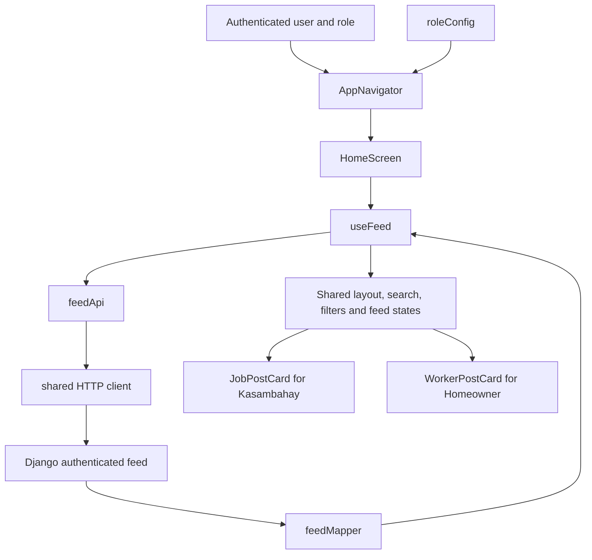

# Frontend architecture

The mobile frontend is organized by feature. Homeowner and Kasambahay use the same Home, Chats, Profile, and Posting screens. Their wording, supported features, and post actions remain explicit. Worker discovery and job browsing keep separate screens because their interactions differ.

## Folder ownership

```text
App.tsx                          Authentication flow and application entry
src/
  app/
    AppNavigator.tsx             Tabs, active role, posting modal
    roleConfig.ts                Role names, posting mode, verification documents
    providers/AppProviders.tsx   Session, language, notifications, safe area
    services/preloadAssets.ts    Post-login preloading across features
  features/
    auth/                        Login, registration, session context
    feed/
      screens/                   HomeScreen, WorkersScreen, JobsScreen
      components/                Home and Browse headers, filters, cards, states
      hooks/                     useFeed, useExploreFeed, useBrowseSwipeDeck
      api/feedApi.ts             Authenticated feed endpoint and query parameters
      feedMapper.ts              Backend response to Home and Explore models
      feedFilters.ts             Home category and search matching
      browsePresentation.ts      Browse copy, quick filters, and empty-state rules
      feedCache.ts               Explore cache keyed by role, token, and filters
      types.ts                   Feed DTOs and view models
    posting/
      screens/PostScreen.tsx     One four-step wizard
      components/                Individual steps
      hooks/usePostForm.ts       Form state, address selection, submission
      api/postingApi.ts          Posting endpoint and idempotency header
      postingConfig.ts           Job/service wording, defaults, descriptions
      validation.ts              Shared rate validation
    profile/
      screens/ProfileScreen.tsx  Profile and personal information composition
      components/                Bio, reviews, settings, pending posts, modals
      hooks/useProfile.ts        Common profile requests and editing state
      worker/                    Resume, reputation, availability, worker hook
      api/accountApi.ts          Account requests
      profileConfig.ts           Role-specific profile copy
    chat/                        Shared inbox, conversation, API, chat store
    bookings/                    Bookings, proposals, saved posts, booking API
    reviews/                     Review forms, lists, review API
    verification/                Documents, camera, face tracking, liveness, API
    notifications/               Notification provider, modal, API
  shared/
    api/config.ts                Local/cloud server selection and URL building
    api/httpClient.ts            Headers, bearer token, timeout, JSON errors
    components/                  AppHeader, GreetingCard, ScreenLayout
    ui/                          Generic pickers, ProfileAvatar, and ErrorNotice
    theme/                       Colors, fonts, spacing
    localization/                Language provider and translated strings
    services/                    Location lookup
    utils/                       Date formatting and image preloading
tests/feature-modules.test.cjs    Domain and request/cache regression checks
```

Create folders when they have a module to hold. Auth and verification still contain substantial existing workflows; their relocation does not imply that every legacy component has been rewritten.

## Home flow



Both roles request `/api/v1/booking/feed/`. The backend selects the opposite account type using authentication. The frontend role controls presentation and actions; it does not provide authorization. Empty responses stay empty. Loading, request errors, an empty feed, and an empty search result have separate UI states.

Home gets fresh data on mount and pull to refresh. Explore uses a 30-second cache keyed by role, session token, and serialized filters. Requests for another session cannot reuse cached results. Clearing the cache invalidates pending writes; a late request cannot replace newer refreshed data. Logout clears feed caches and the existing chat/saved-post stores. Successful posting invalidates Explore caches.

Search and filter selections remain local to each screen. Custom hooks share logic, while each invocation owns its state. Existing React contexts and stores remain in use; no new state management dependency was introduced.

## Role differences

| Area | Homeowner | Kasambahay |
| --- | --- | --- |
| Home feed | Worker service posts; message worker | Employer job posts; apply and chat |
| Browse | WorkersScreen | JobsScreen |
| Posting | Job copy and rate defaults | Service copy and rate defaults |
| Profile | Common profile sections | Common sections plus resume, reputation, availability |
| Required documents | National ID front and back | NBI and police clearances |

`roleConfig.ts` owns account capabilities and navigation choices. `postingConfig.ts` owns posting copy and descriptions. `profileConfig.ts` owns profile copy. Keep genuinely different card layouts and workflows in dedicated components rather than adding many role checks to a generic component.

## Public profiles and proposals

Own and public profiles share `profileStyles`, `ProfileTabs`, `PendingPostCard`, and `ReviewsSection`. Public profiles keep the same identity card, bio, and Posts/Reviews layout, with read-only identity details and viewer actions in place of editing or cancelling controls. Contact numbers and social links follow the public-profile API's privacy settings.

`usePublicProfile` loads identity, reviews, and open posts, and ignores responses from a previously viewed profile. `/api/v1/booking/profile/<user_id>/pending/` returns only that active user's Pending posts and the viewer's own latest proposal status. It does not return other applicants' proposals or contact details.

Kasambahay can Apply to a homeowner's post; homeowners can Offer to Hire from a kasambahay's post. Both submit the existing booking proposal API with a daily rate and optional message. The backend validates verification, roles, rate, post status, and duplicate pending proposals, then notifies the owner. The post remains pending until the owner responds through My Pending Posts → Manage Post → Offers. These profile actions do not immediately accept a booking.

For manual testing, submit a proposal from the opposite account, reopen the public profile to confirm Application Sent/Offer Sent, then sign in as the owner and review the notification and offer. Accept it and refresh the public profile: the confirmed post should disappear from Pending Posts.

## How to extend it

1. Put endpoint requests in the owning feature's `api` folder. Use the shared HTTP client; pass the session token explicitly. Keep response error handling that is specific to the endpoint in the feature.
2. Convert backend fields into display models in a mapper. Components should not repeatedly interpret `booking_id`, category labels, or rate units.
3. Put reusable fetching and state transitions in a hook. Screen components assemble the hook, UI sections, and navigation callbacks.
4. Keep feature-specific UI with its feature. Move UI to `shared` when it is independent of any feature. Shared modules must not import from `features` or `app`.
5. Reuse the role configuration for role decisions. Backend permissions and validation remain authoritative.

Cross-feature workflows can import explicit modules from another feature. Application-level orchestration belongs in `app`. For example, generic image preloading lives in `shared`, while preloading an authenticated chat inbox lives in `app/services`.

## Browse presentation

WorkersScreen and JobsScreen share BrowseHeader, BrowseFilters, BrowsePostCard, BrowseActivityCard, and deck loading/empty states. Both use the theme's peach accent and the same typefaces. Both headers show the signed-in user's avatar. Explore keeps the original swipe deck: a large profile photo fills each card, with the post information overlaid at the bottom and small X/heart controls at its edges. There are no Skip/Apply/Message buttons below the deck. Missing or failed photos use initials rather than an unrelated person's photo.

Kasambahay keeps Explore, Saved, and Applied tabs with Apply actions. Homeowner keeps Explore and Saved tabs with Message actions. Category and booking-type chips behave consistently for both roles. Service rates use the backend's daily or monthly unit, rather than a fixed hourly label. Saved posts retain their author's identifier so profile and chat actions target the author.

An empty response shows “No jobs available yet” or “No services available yet.” Exhausting a populated deck shows “You're all caught up!” Filtered-empty results offer Clear Filters, and request failures offer Try Again. The shared swipe hook handles horizontal gestures without capturing ordinary button taps or vertical scrolling, cancels when the active card changes, and prevents duplicate swipe actions during animation.

## Verification and local testing

From `front_end_2/SerbiSure-Frontend`:

```powershell
npm run typecheck
npm run test:modules
npm start -- --clear
```

The module tests use mocked HTTP responses and do not connect to a database. They cover role configuration, response mapping, search/filter combinations, posting defaults and descriptions, existing rate validation, HTTP headers/errors, cache session isolation, refresh races, and shared-layer boundaries. Metro cache clearing is useful after the folder moves.

If the editor reports missing imports inside an old path such as `src/screens/homeowner/HomeScreen.tsx`, close that obsolete tab and open `src/features/feed/screens/HomeScreen.tsx`. Run `npm run typecheck` to check the files on disk. In VS Code or Antigravity, use **TypeScript: Restart TS Server** from the Command Palette, or **Developer: Reload Window** if old diagnostics remain. Avoid saving an obsolete tab back to its old path, which would recreate the removed duplicate screen.

Server selection now lives in `src/shared/api/config.ts`. The existing local/cloud configuration was preserved. The backend database setting remains in the backend; this refactor does not create or migrate database records.

Use a local Homeowner and Kasambahay account for this manual checklist:

- Log in with each role. Check greeting, avatar, notification bell, tab navigation, and logout.
- With no opposite-role posts, confirm Home shows its empty state without example people. Pull to refresh.
- Create one local job and one local service. Check that the opposite role sees it with the correct rate unit, category, name, address, and details.
- Combine Home search and category chips. Test reset filters, no matching results, and View All.
- Open profiles and chat from both feeds. Save and unsave posts. Check saved posts after changing tabs.
- Browse workers as Homeowner and jobs as Kasambahay. Check filtering, refresh, swipe/card interactions, application state, and saved/applied tabs.
- Compare both Browse screens: header avatar, profile photos, colors, filter buttons, and card spacing should match. Test a missing or broken photo, an empty database, filters with no results, a failed request, and swiping through all results. Confirm profile, bookmark, and details buttons still respond to taps and cards scroll vertically with the page.
- Open the posting wizard for both roles. Change engagement type, check rate defaults, go back between steps, edit address and instructions, review the preview, submit, and check success/error handling.
- Check that an unverified account reaches verification and that a verified account can post. Homeowner requires ID; Kasambahay requires clearances.
- Edit bio, tags, social links, privacy, avatar, and personal information. Check reviews and pending posts. Confirm resume, availability, and reputation appear only for Kasambahay.
- Test document upload and liveness on a device with the existing native development build. Check chat unread counts, notifications, and booking/proposal actions.
- Log out and sign in as the other role. Confirm previous account data is cleared.

TypeScript, module tests, and bundling cannot validate camera access, native document pickers, on-device layout, or live backend permissions. Run those checks on the device before committing this refactor.
